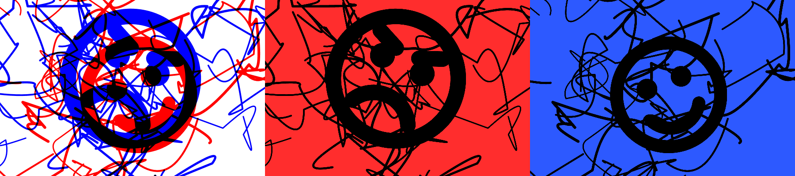
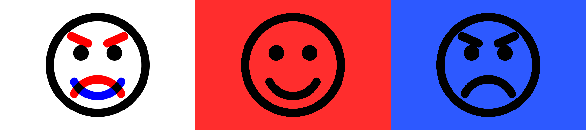
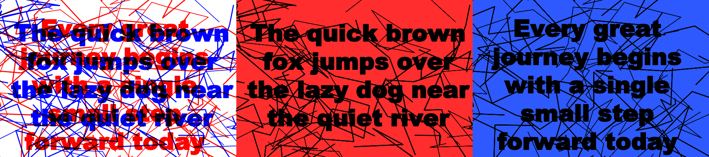
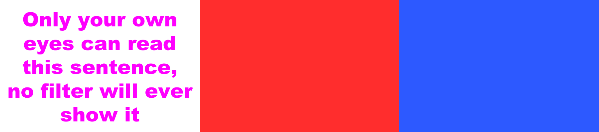

# Red/Blue Lens

A tiny web app that reveals **hidden drawings and messages** using the red/blue colour-filter trick.

Two images (or two sentences) are drawn on top of each other, one in **blue ink** and one in **red ink**. To the naked eye they are a tangled mess. Look through a **red filter** and the red ink disappears, leaving only the blue image. Look through a **blue/cyan filter** and the blue ink disappears, leaving only the red one.

This project does the same thing digitally: it opens your phone camera and applies a virtual red or blue filter, so you can read the puzzles without any physical glasses. It also includes a puzzle generator so you can make your own and print them.

## Try it in 30 seconds

| | |
|---|---|
| 📷 **[Open the camera](https://maximusashraf.github.io/red-blue-lens/)** | Live camera with *Normal / Red / Blue* filters. Works on your phone. |
| ✏️ **[Make your own puzzle](https://maximusashraf.github.io/red-blue-lens/make.html)** | Type two sentences or pick two shapes, preview them through both filters, download and print. |

1. Open the camera link, allow the camera, and point it at a puzzle from this page (on screen or printed).
2. Switch between **Red filter** and **Blue filter**. A different hidden picture appears in each.
3. Want your own? Open the puzzle page, make one (or upload an image), then tap **Open in camera** to test it right away.

The app is in **English by default**. Tap **عربي** in the top corner for Arabic (right-to-left); it remembers your choice.



*Left: what you see on paper. Middle: through the red filter (only the blue drawing survives). Right: through the blue filter (only the red drawing survives).*



Sentences work the same way. Here two 10+ word English sentences are printed on top of each other (with scribbles), so the page is unreadable by eye:

- Blue: *"The quick brown fox jumps over the lazy dog near the quiet river"*
- Red: *"Every great journey begins with a single small step forward today"*



### Bonus: a message only the naked eye can read

Ink that has both a lot of red and a lot of blue, like **magenta** (`#ff00ff`), is bright in the red channel *and* in the blue channel. Both filters treat it like white paper, so it vanishes in both views. Without a filter it stays perfectly readable.



*Left: normal view. Middle: red filter. Right: blue filter. The sentence disappears in both.*

You can combine all three inks on one page: blue and red for the two hidden messages, and magenta for a message that only people *without* a filter can read.

## How it works

The filter is just a per-pixel channel pick, with a contrast boost:

| Filter | Channel used as brightness | Red ink looks | Blue ink looks |
|--------|----------------------------|---------------|----------------|
| Red    | R                          | white (hidden) | dark (visible) |
| Blue   | B                          | dark (visible) | white (hidden) |

White paper is bright in every channel, so it stays bright. Pure red `#ff0000` has full R and no B, and pure blue `#0000ff` is the opposite. That is the whole trick.

When generating puzzles, both layers are drawn with the canvas `multiply` blend mode. Where they overlap the pixel turns black, which is dark in *both* views, so each hidden image stays complete.

## Features

- **Two pages**: `index.html` (camera) and `make.html` (puzzle maker), English and Arabic.
- **Camera page**: a clean live camera with *Normal / Red filter / Blue filter* buttons. The *Start camera* button only appears if the browser has not already allowed the camera, and if access is blocked the page shows step-by-step help for iPhone, Android and desktop, with Try again, Reload and Copy settings address buttons.
- **Upload an image** (on the puzzle page): load a photo or screenshot of a puzzle and see it through both filters.
- **Text puzzles**: type two sentences, they are auto-wrapped to fill the canvas with the largest possible font, then overlaid in blue and red.
- **Shape puzzles**: pick two of 12 shapes. Difficulty levels add random scribbles, rotation and offsets so the shapes are hard to make out by eye. The hidden shape is drawn with a thicker stroke than the noise so it stands out under the filter.
- **Preview** of the normal, red-filtered and blue-filtered result before you print.
- **PNG export** for printing.
- Plain static HTML/JS, no build step, no dependencies. The UI is in Arabic (RTL), and the puzzle text can be in any language.

## Run it locally

The camera API needs a secure context (`https://` or `localhost`). From the repo root:

```bash
cd docs
python3 -m http.server 8000
# open http://localhost:8000
```

The `docs/` folder is a static site, so it is also what GitHub Pages serves. You can deploy it to any static host. Without HTTPS the live camera is blocked by the browser. You can still preview a puzzle through both filters on the puzzle page.

## Real-world use (no app needed)

You can do this with physical filters too:

- Red/cyan 3D glasses (close one eye and look through the other lens)
- Red and blue/cyan cellophane or transparent plastic sheets
- Draw one picture with a blue pen and another with a red pen on the same paper

Print puzzles in saturated, pure red and blue. Duller inks reduce how well each filter separates the two layers, so test one page first.

## Project layout

```
docs/index.html     camera page (served by GitHub Pages)
docs/make.html      puzzle maker page
docs/shared.js      translations (en/ar), header, filter code
docs/shared.css     styles
docs/*-strip.png    images used in this README
```

## License

MIT
